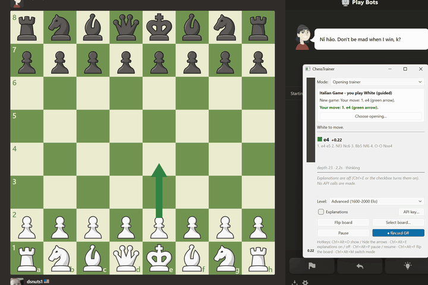
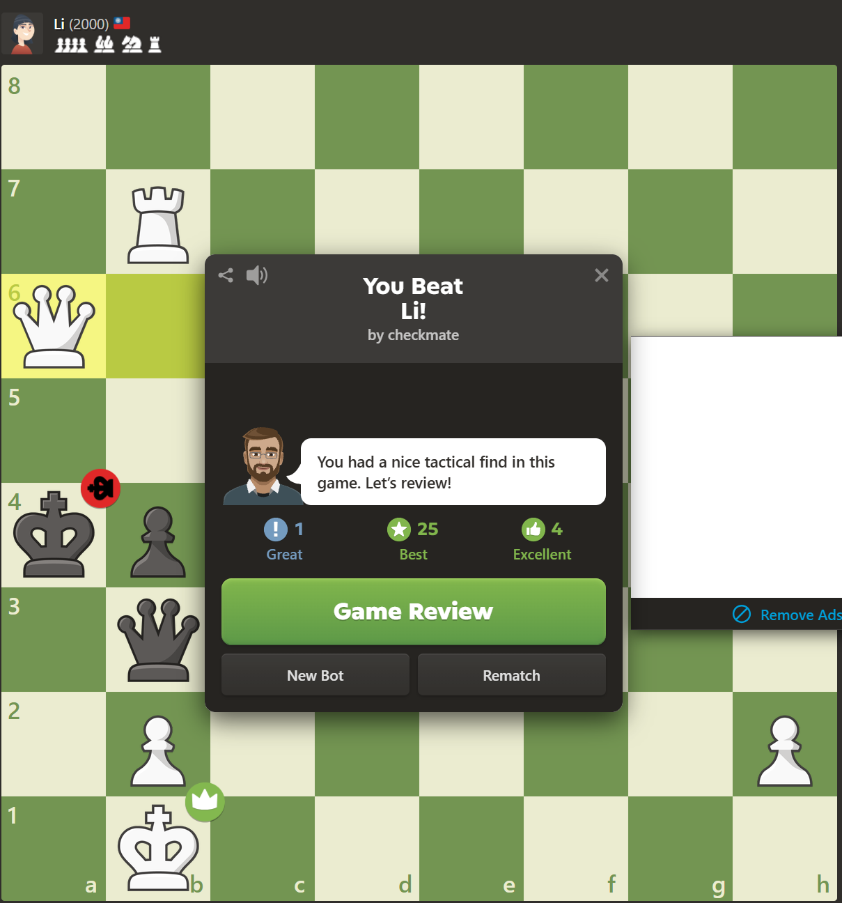
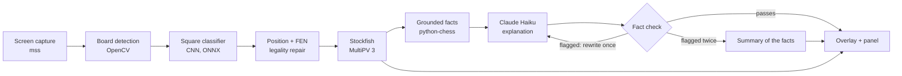

<div align="center">

# ChessTrainer

**A chess coach that sits on top of any board on your screen: best-move arrows, explanations that stick to the facts, an opening trainer and game reviews.**

[](LICENSE)
[](https://github.com/simonlunay/ChessTrainer/actions/workflows/ci.yml)
[](https://www.python.org/)
[](https://github.com/simonlunay/ChessTrainer/releases/latest)




</div>

ChessTrainer reads the position from a screen capture, runs Stockfish, and draws the best move
right on the board. It works on lichess, chess.com, a YouTube video or a PDF. No browser
extension, no site integration.

> **Fair play.** ChessTrainer is built for analysis boards, games against bots, and reviewing
> your own games. Do not use it in live rated games. That is cheating on every site, and it
> will get your account closed.

## Quick start

1. **Download** `ChessTrainer-<version>-windows-x64.zip` from
   [Releases](https://github.com/simonlunay/ChessTrainer/releases/latest), unzip it anywhere and
   run `ChessTrainer.exe`.
2. **Stockfish is included** (Stockfish 19). Nothing to install. Pick your level in the first
   dialog.
3. **Optional: explanations.** Paste an [Anthropic API key](https://console.anthropic.com/settings/keys)
   in the same dialog (or later with the panel's **API key…** button). It is stored in Windows
   Credential Manager. Without a key everything else works.

Open a game in any app. The green arrow is the move to play.

Windows may show "Windows protected your PC" because the exe is not code-signed. Click
**More info → Run anyway**.

## Features

| | |
|---|---|
| **Reads any board** | A small CNN classifies all 64 squares. Any site, any theme, flipped boards, highlights and arrows. |
| **Best-move overlay** | Click-through arrows aligned to the pixel, an eval bar and the top lines. New position to arrows in ~230 ms. |
| **Grounded explanations** | Plain English at your level, written only from facts computed by python-chess and Stockfish, then fact-checked. |
| **Five skill levels** | Beginner (<800) to Expert (2000+): how many moves you see, simpler practical moves, explanation style. |
| **Opening trainer** | Any opening from the Lichess dataset. Guided mode explains each book move; practice mode drills you with spaced repetition. |
| **Game review** | Paste a PGN or load your Lichess / Chess.com games. Mistakes graded for your level, typed, explained, summarized. |
| **Global hotkeys** | Arrows, explanations, pause, flip and mode, even while the browser has focus. |
| **Private by default** | Hidden from screen capture. Explanations off means zero API calls. Your key never leaves your machine except to Anthropic. |

<p align="center">
  
</p>
<p align="center"><sub>A win against chess.com's 2000-rated bot with ChessTrainer running. The
overlay hides itself from screen capture, so only the board shows here.</sub></p>

## How it works



**Screen capture.** `mss` grabs the monitor at 10 fps. Once a board is found, only its
neighbourhood is grabbed (~12 ms instead of ~45 ms for a 2560x1600 screen).

**Board detection.** Edge contours, a lattice fit on edge projections, and a checkerboard colour
check find the 8x8 grid. A tracker re-verifies the box each frame and re-finds a dragged window
by template matching.

**Square classifier.** A VGG-style CNN (585k parameters) labels each square as empty or one of 12
pieces. It is trained only on synthetic boards: 10 free-licence piece sets, 17 textures, random
palettes, site clutter and degradation. It ships as ONNX and runs on the CPU through OpenCV.

**Position and FEN.** Impossible readings are repaired (two kings, pawns on the back rank). Each
new frame is explained as no change, one or two legal moves, or a takeback, which gives the exact
side to move, castling rights and en passant. A change must hold for 2 frames.

**Stockfish.** Runs in a background thread with MultiPV 3. A new position stops the old search;
stale results are dropped by request id.

**Grounded facts.** python-chess computes what is true about the move: captures, checks, threats,
forks, pins, skewers, discovered attacks, material over the line, pawn structure, development.

**Explanation.** Only those facts, the move and your level go to Claude Haiku. Never the board.

**Overlay.** A transparent click-through window covers the board, snapped to whole physical
pixels, and is excluded from screen capture so the app never reads its own arrows.

## Why it doesn't hallucinate

LLMs are bad at reading chess positions. So the model never sees one.

1. **Facts first.** python-chess and Stockfish compute every claim the explanation may make. Each
   fact is a tag plus one plain sentence ("Nf3 attacks the pawn on e5").
2. **Facts only.** The prompt contains the move, the level and the facts. The system prompt bans
   claims not in the facts, upgraded strength words ("brilliant", "winning") and meta-talk.
3. **Fact check.** A rule-based checker scans every answer for squares, moves, piece placements,
   concepts, numbers and verdict words that are not in the facts.
4. **Regenerate once, then fall back.** A flagged answer is rewritten once with the flagged claims
   listed. If the rewrite is flagged too, the app shows a summary built from the facts themselves.

Measured results:

| Measure | Result |
|---|---|
| Explanations with any claim not in the facts (strict LLM judge, 150 explanations) | 7-9% before the live check |
| Unsupported claims overall | ~1% of ~930 claims |
| Live path, opening trainer (73 explanations) | 71 passed first time, 2 rewritten, 0 fell back |
| Live path, game review (15 explanations) | 13 passed first time, 2 rewritten, 0 fell back |
| Positions from real screenshots | 0 of 25 flagged |

What remains is mostly causal glue ("because X, Y") or loose wording, not invented tactics.

## Results

All numbers come from the eval scripts in `scripts/`. Hardware: RTX 3060 laptop, 20-thread
Intel CPU, 150% display scaling.

**Piece classifier** (per-square accuracy)

| Set | Dev model (25 sets) | Shipped model (free sets only) |
|---|---|---|
| Validation | 99.61% | 99.03% |
| Held-out piece sets, textures, palettes | 99.88% | 99.59% |
| Real lichess / chess.com renders | 97.76% | 97.78% |

**Board reading** (exact positions)

| Test | Result |
|---|---|
| Real user screenshots | 11/11, orientation found automatically |
| Lichess renders | 20/20 |
| Chess.com renders, auto / given orientation | 25/40 / 31/40 (shipped model) |
| Live self-test, real game on screen | 23/23 incl. castling and en passant |

**Speed and alignment**

| Measure | Result |
|---|---|
| New position on screen to arrows | median 226 ms, max 259 ms |
| Real lichess in Chrome, key press to arrows | median 386 ms (includes the site's ~250 ms animation) |
| Arrow alignment | within 2.4 px of square centres |
| Classifier, CPU only (ONNX, 20 threads / 1 thread) | 41 ms / 214 ms per board |

**Opening trainer and review**

| Measure | Result |
|---|---|
| Scripted trainer scenarios (transpositions, deviations, takebacks, practice) | 15/15 |
| Real games reviewed (Lichess + Chess.com APIs, sample PGNs) | 10 games, ~0.14 s per position |
| Packaged app | 379 MB folder, 194 MB zip, no PyTorch, audit clean |

## Hotkeys

| Hotkey | Action |
|---|---|
| Ctrl+Alt+O | Show / hide arrows |
| Ctrl+Alt+E | Explanations on / off |
| Ctrl+Alt+P | Pause / resume |
| Ctrl+Alt+F | Flip the board |
| Ctrl+Alt+M | Switch mode: analysis → opening trainer → game review |

In the review window: ← / → step through moves, **N** jumps to your next mistake.

## Settings

Most settings are in the side panel. Everything is saved in
`%APPDATA%\ChessTrainer\settings.json`.

| Key | Default | What it does |
|---|---|---|
| `skill_level` | `beginner` | `beginner`, `novice`, `intermediate`, `advanced`, `expert` |
| `explanations` | `true` | Off = no API calls at all |
| `explain_model` / `explain_effort` | `claude-haiku-5-5` / `medium` | Model and effort for explanations |
| `explain_delay_s` | `1.5` | Position must be stable this long before it is explained |
| `engine_path` | `null` | Your own Stockfish; `null` = bundled or `STOCKFISH_PATH` |
| `engine_threads` / `engine_hash_mb` | `4` / `128` | Stockfish resources |
| `engine_max_seconds` | `8.0` | Analysis time per position |
| `capture_fps` / `monitor` | `10` / `1` | Capture rate and monitor (0 = all) |
| `orientation` | `auto` | `auto`, `white` or `black` at the bottom |
| `classifier_backend` / `device` | `auto` / `auto` | `onnx` or `torch`; `cpu` or `cuda` |
| `hide_overlay_from_capture` | `true` | Keep the overlay out of screenshots and recordings |
| `global_hotkeys` / `hotkeys` | `true` / `{}` | e.g. `{"flip": "Ctrl+Shift+F9"}`; `""` disables one |
| `review_depth` / `review_explain_max` | `14` / `3` | Review engine depth; explained mistakes per game |

Environment variables: `ANTHROPIC_API_KEY` (overrides the stored key), `STOCKFISH_PATH`,
`CHESSTRAINER_HOME` (settings folder), `CHESSTRAINER_WEIGHTS_URL` (weights mirror).

## FAQ

**What does an explanation cost?** About $0.0003-0.0006 with Claude Haiku (measured), so $1 covers
roughly 2,000. Repeated positions come from a local cache for free. You use your own key and
Anthropic bills you directly.

**Does it work offline?** Yes, except explanations and loading games by username. Board reading,
Stockfish, the opening trainer and PGN review are fully local.

**Which sites?** Any board on screen. Tested on lichess.org and chess.com renders and real
screenshots. Unusual chess.com piece sets ("8-bit", "light") are the weak spot.

**Do I need a GPU?** No. The shipped classifier runs on the CPU: 41 ms per board on a 20-thread
laptop CPU, 214 ms on a single thread. The board is only re-classified when it changes.

**Mac or Linux?** Not yet. Screen capture exclusion, hotkeys and the build are Windows-only.

**Is my API key safe?** It is stored in Windows Credential Manager, never in settings.json, never
logged, and only sent to Anthropic. A `.env` file in `%APPDATA%\ChessTrainer\` also works.

## Build from source

Requires Windows 10/11, Python 3.11+ and [uv](https://docs.astral.sh/uv/) (`pip install uv`).

```powershell
python -m uv sync                                # .venv (CUDA PyTorch for training; CPU works too)
python -m uv run python -m chesstrainer.vision.weights   # shipped weights from the release
python -m uv run chesstrainer                    # run the app
```

Put Stockfish in `data/engine/` or set `STOCKFISH_PATH` ([download](https://stockfishchess.org/download/)).
The weights are also fetched automatically on first launch.

Train your own classifier, build the exe, and run the evals:

```powershell
python -m uv run python scripts/download_assets.py               # piece sets + textures (training only)
python -m uv run python -m chesstrainer.vision.train --free-only # ~13 min on an RTX 3060
python -m uv run python -m chesstrainer.vision.export_onnx       # -> square_classifier_free.onnx
python -m uv run python scripts/build_exe.py                     # dist\ChessTrainer + audit + self-check
python -m uv run python scripts/cpu_benchmark.py                 # CPU-only timing on real boards
python -m uv run pytest                                          # 164 tests, offscreen
```

## Known limitations

- Rare chess.com piece sets ("8-bit", "light") misread. Fix: more styles in training.
- Boards without coordinates in random or endgame positions can have ambiguous orientation.
  Flip with Ctrl+Alt+F.
- A position seen without history may guess the side to move. The panel flags it.
- About 1 in 12 explanations adds a harmless unstated inference. Positional facts are basic
  (no outposts or plans), so quiet moves get plain explanations.
- Mistake types are heuristics over 8-ply lines.
- The exe is not code-signed.

## Roadmap

- More piece styles and real screenshots in training and evals
- Richer positional facts: outposts, king safety, space, plans
- Explanations streaming in while a review is still running
- Signed installer and auto-update
- macOS and Linux capture and hotkeys

## Contributing

Bug reports, screenshots of boards it misreads, and pull requests are welcome. See
[CONTRIBUTING.md](CONTRIBUTING.md).

## Credits and licences

ChessTrainer is licensed under the [GPL-3.0](LICENSE).

- [Stockfish](https://stockfishchess.org/) (GPL-3.0), bundled with its source
- [python-chess](https://github.com/niklasf/python-chess) (GPL-3.0+) by Niklas Fiekas
- [PyQt6](https://www.riverbankcomputing.com/software/pyqt/) (GPL-3.0) and Qt 6 (LGPL-3.0)
- [Lichess chess-openings](https://github.com/lichess-org/chess-openings) (CC0) for the opening book
- Piece sets and board textures from [lila](https://github.com/lichess-org/lila), used only to
  render training data and never redistributed. The shipped model uses free-licence sets only.
- Explanations by [Claude](https://www.anthropic.com/claude) through the Anthropic API

Full list with authors and licences: [THIRD_PARTY_NOTICES.md](THIRD_PARTY_NOTICES.md).
ChessTrainer is not affiliated with Lichess, Chess.com or Anthropic.
